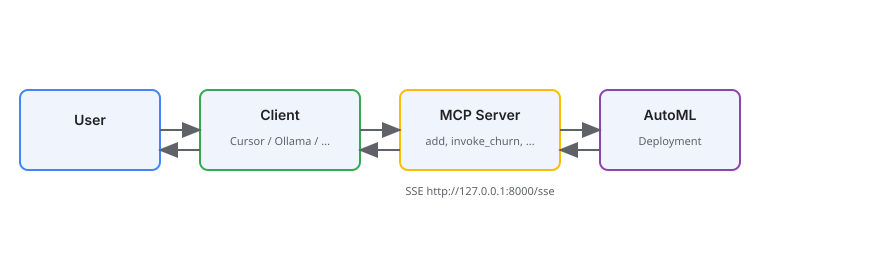

<!-- Assisted-by: Cursor -->
# MCP AutoML Server

An MCP (Model Context Protocol) server that exposes **config-driven tools** backed by JSON schemas. Tools are defined in a YAML file; each tool gets its input shape from a JSON Schema and can optionally call an HTTP deployment (e.g. AutoML) with the validated payload.

Use it with LangChain/LangGraph and an LLM to turn natural language into structured tool calls and deployment invocations (e.g. churn prediction). You can also attach this MCP server to **Cursor** or **Ollama** (see [Attaching to Cursor and Ollama](#attaching-to-cursor-and-ollama)).

## How to use the MCP server

1. **Start the MCP server** (`make run-mcp` from the parent `mcp_agent/` directory). It exposes tools over SSE at `http://127.0.0.1:8080/sse`.
2. **Connect a client** — Cursor, the demo script (`interact_with_mcp.py`), or an Ollama MCP client — to that URL.
3. **Ask questions or run actions**; the client sends your request to the LLM, which can call the server’s tools (e.g. `add`, `invoke_churn`). If a tool is configured with a deployment, the server calls your AutoML deployment and returns the result.

**Diagram:** The flow is shown below.



## Why use the MCP server?

Using the **MCP server and tools** is better when you want to:

- **Use natural language** — Ask in plain language (“Will this customer churn? They have 12 months tenure, Month-to-month contract, $70 monthly charges.”). The client’s LLM turns that into a structured tool call; you don’t hand-craft JSON or manage field names and enums yourself.
- **Integrate with AI assistants** — Cursor, Ollama clients, and other MCP-aware tools discover and call your deployment as a **tool**. The model chooses when to call it and how to interpret the result, so you get a conversational flow instead of writing one-off scripts.
- **Reuse one endpoint across clients** — One MCP server URL works from Cursor, the demo script, LangGraph agents, and any MCP client. Raw requests mean separate integration code per environment.
- **Enforce and validate input** — The server turns your JSON Schema into a tool contract: required vs optional fields, enums, and types. Invalid or missing inputs are caught before the deployment is called; with raw requests you must validate and format the body yourself.
- **Keep credentials and URL in one place** — The server reads `DEPLOYMENT_URL` and `DEPLOYMENT_TOKEN` from the environment. Clients only need the MCP server URL; they never see or store deployment credentials.

For quick tests or custom pipelines, raw requests are fine (see the notebook). For chat-based or multi-client use, the MCP server is the better fit.

## Features

- **Schema-driven tools**: Define tools by name, description, and path to a JSON Schema; the server builds Pydantic models and flat tool parameters from the schema.
- **Required vs optional**: The JSON Schema `required` array controls which parameters are required; omitted optional parameters are set to `None`.
- **Deployment integration**: Optionally POST validated input to an HTTP endpoint (e.g. AutoML deployment) using an env-based URL and an optional Bearer token.
- **SSE transport**: Server runs over SSE for use with MCP clients (e.g. `interact_with_mcp.py` with LangGraph).

## Directory structure

```text
mcp_automl_template/
├── pyproject.toml      # Project metadata and dependencies
├── mcp_server.py       # FastMCP server; registers example tools + tools from YAML
├── register_tools.py   # Loads tools_config.yaml, builds tools from JSON schemas
├── tools_config.yaml   # Tool definitions: name, description, schema_path, deployment env vars
├── churn_schema.json   # JSON Schema for churn prediction tool input
├── utils.py            # json_schema_to_pydantic_model, LLM client (OpenAI-compatible)
├── interact_with_mcp.py # Client: connects via SSE, loads MCP tools, runs LangGraph agent
└── README.md
```

## Prerequisites

- Python 3.12+
- For deployment tools: an HTTP endpoint (e.g. AutoML deployment) and its URL (plus a Bearer token if the endpoint requires one)
- For the demo client: an LLM (Ollama, OpenAI, or OGX)

## Setup

1. **Install dependencies**

   With [uv](https://docs.astral.sh/uv/):

   ```bash
   uv sync
   ```

2. **Environment**

   The `make` targets in the parent `mcp_agent/` directory read `../.env`. Create it from `.env.example`:

   ```bash
   cd ..
   make init
   ```

   Variables used by this server and the demo client:

   - `DEPLOYMENT_URL` – prediction endpoint URL (`<inference endpoint>/v1/models/<deployment-name>:predict`)
   - `DEPLOYMENT_TOKEN` – (optional) Bearer token for that endpoint; leave empty if token auth is off
   - `DEPLOYMENT_CA_BUNDLE` – (optional) CA bundle used to verify the endpoint's TLS certificate (see [AUTOML_DEPLOYMENT.md](AUTOML_DEPLOYMENT.md#53-tls-for-in-cluster-https-endpoints))
   - `BASE_URL` – LLM base URL (for `interact_with_mcp.py` via `get_chat_from_env()`)
   - `API_KEY` – LLM API key
   - `MODEL_ID` – model identifier (e.g. `llama-3.1-8b-instruct`)

   Without `DEPLOYMENT_URL`, `invoke_churn` returns the validated input instead of a prediction, which is enough to test tool calling.

## Configuration

### Tools: `tools_config.yaml`

Each entry under `tools` defines one MCP tool:

| Key | Required | Description |
|-----|----------|-------------|
| `name` | Yes | MCP tool name (e.g. `invoke_churn`) |
| `description` | Yes | Description for the LLM |
| `schema_path` | Yes | Path to JSON Schema file (relative to the config file) |
| `deployment_url_env` | No | Env var name for the deployment URL |
| `deployment_token_env` | No | Env var name for the Bearer token |

If the URL env var is set, the tool POSTs the validated input (as `instances`) to that URL, adding an `Authorization: Bearer` header when the token env var is also set. Otherwise the tool returns the validated payload as a dict.

Example:

```yaml
tools:
  - name: invoke_churn
    description: Invoke deployment for Telco customer churn prediction.
    schema_path: churn_schema.json
    deployment_url_env: DEPLOYMENT_URL
    deployment_token_env: DEPLOYMENT_TOKEN
```

### Input schema: `churn_schema.json`

Standard JSON Schema with `properties` and `required`. Field types and `required` are respected: required parameters have no default; optional ones default to `None` when not provided. The server also coerces the string `"null"` to `None` for optional fields.

## Deploying to OpenShift

The MCP AutoML server deploys to OpenShift using the shared Helm chart. From the parent `mcp_agent/` directory:

### Prerequisites

- `oc` CLI installed and logged in to your OpenShift cluster
- [Helm 3](https://helm.sh/docs/intro/install/) installed
- `DEPLOYMENT_URL` (and `DEPLOYMENT_TOKEN` if token auth is on) set in `.env` (see `.env.example`)

### Deploy

```bash
cd agents/autogen/templates/mcp_agent
make deploy-mcp
```

This builds the container image in-cluster via OpenShift BuildConfig and deploys using `helm upgrade --install`. The Route URL is printed on success.

### Preview rendered manifests

```bash
make dry-run-mcp
```

### Remove

```bash
make undeploy-mcp
```

## Running the MCP server

From the parent `mcp_agent/` directory:

```bash
make run-mcp
```

This starts the FastMCP server with SSE on `http://127.0.0.1:8080/sse`. Built-in tools (`add`, `sub`) and all tools from `tools_config.yaml` are registered.

## Testing with the demo client

With the MCP server running, in another terminal (from `mcp_agent/`):

```bash
make interact-mcp
```

This connects to the server via SSE, loads MCP tools, and runs a LangGraph ReAct agent with the configured LLM. You can type questions or use predefined prompts. The agent will call tools (e.g. `invoke_churn`) when appropriate.

## Attaching to Cursor and Ollama

The server exposes MCP over **SSE** at `http://127.0.0.1:8080/sse` (or `http://localhost:8080/sse`). You must **start the server first**, then attach it from Cursor or an Ollama-capable client.

**Start the server** (from the parent `mcp_agent/` directory):

```bash
make run-mcp
```

Keep this process running while using Cursor or Ollama.

### Cursor

1. **Start the MCP server** (see above).
2. **Add the server in Cursor:**
   - **UI:** **Settings** (`Cmd + ,` / `Ctrl + ,`) → **Tools & MCP** → **Add new MCP server** → choose **streamable HTTP** (SSE) and set **URL** to `http://127.0.0.1:8080/sse` (name e.g. `automl`).
   - **Config file:** Create or edit `.cursor/mcp.json` in your project (or `~/.cursor/mcp.json` for all projects):

   ```json
   {
     "mcpServers": {
       "automl-churn": {
         "url": "http://127.0.0.1:8080/sse"
       }
     }
   }
   ```

3. Restart Cursor or reload MCP servers. The tools (`add`, `sub`, `invoke_churn`, etc.) will appear for the AI.

**Note:** Cursor must be able to reach the server; leave the terminal with `mcp_server.py` running (or run it in the background).

### Ollama

Ollama’s CLI does not run MCP clients. To use this MCP server with Ollama you need an app or client that supports both Ollama and MCP:

- **Ollamac** (macOS): In MCP settings, add a **remote** server with URL `http://127.0.0.1:8080/sse` (with this MCP server already running). Use a tool-capable model (e.g. Llama 3.1+, Mistral).
- **Other MCP clients:** Any client that supports SSE can use `http://127.0.0.1:8080/sse` once this server is running.

**Alternative:** Use the included demo client (`make interact-mcp`). It uses `get_chat_from_env()` (same `BASE_URL` / `MODEL_ID` / `API_KEY` as the main agent). For local Ollama, set those in `.env` (see the parent `.env.example`). The agent will call this MCP server’s tools using that LLM.

## Expected output

Calling `invoke_churn` over MCP with `{"tenure": 2, "Contract": "Month-to-month", "MonthlyCharges": 95.0, "InternetService": "Fiber optic"}`:

- **Without `DEPLOYMENT_URL`**, the tool returns the validated input. Every schema field is present, and omitted optional fields are `null`. This is the exact payload that would be sent to the model as `instances`:

  ```json
  {
    "gender": null,
    "SeniorCitizen": null,
    "Partner": null,
    "Dependents": null,
    "tenure": 2,
    "PhoneService": null,
    "MultipleLines": null,
    "InternetService": "Fiber optic",
    "OnlineSecurity": null,
    "OnlineBackup": null,
    "DeviceProtection": null,
    "TechSupport": null,
    "StreamingTV": null,
    "StreamingMovies": null,
    "Contract": "Month-to-month",
    "PaperlessBilling": null,
    "PaymentMethod": null,
    "MonthlyCharges": 95.0,
    "TotalCharges": null
  }
  ```

- **With `DEPLOYMENT_URL`** pointing at the deployed churn model, the tool returns the predicted `Churn` label — the first element of the response's `predictions` array. Captured from a live run on RHOAI 3.6 (AutoML-trained churn model, tool call made through the AutoGen agent):

  ```json
  {
    "name": "invoke_churn",
    "arguments": {
      "tenure": 2,
      "Contract": "Month-to-month",
      "MonthlyCharges": 95.0,
      "InternetService": "Fiber optic"
    },
    "result": "[{\"type\": \"text\", \"text\": \"Yes\", \"annotations\": null}]",
    "is_error": false
  }
  ```

  The model answers `{"predictions":["Yes"]}` and the tool surfaces the first prediction. If the response has no `predictions`, the tool returns the full response body.

## Adding a new tool

1. Add a JSON Schema file (e.g. `other_schema.json`) with `properties` and optional `required`.
2. In `tools_config.yaml`, add an entry with `name`, `description`, `schema_path`, and optionally `deployment_url_env` and `deployment_token_env`.
3. Restart the MCP server.

No code changes are required; tools are created from the YAML and schema at startup.

## AutoML experiment and deployment

For a full walkthrough of training a churn model with AutoML on Red Hat OpenShift AI 3.6, deploying it, and using it with this MCP server, see **[AUTOML_DEPLOYMENT.md](AUTOML_DEPLOYMENT.md)**. It is based on the [Red Hat AI examples – Predict Customer Churn tutorial](https://github.com/red-hat-data-services/red-hat-ai-examples/blob/main/examples/automl/churn_prediction_tutorial.md) and covers:

1. Creating a project, S3 connections, and a pipeline server with the AutoML managed pipelines.
2. Running AutoML from **Develop & train → AutoML** and reviewing the leaderboard.
3. Registering the model (Model Registry) and deploying it with the built-in AutoGluon ServingRuntime for KServe.
4. Setting `DEPLOYMENT_URL` (plus optional `DEPLOYMENT_TOKEN` / `DEPLOYMENT_CA_BUNDLE`) and using the deployment with the MCP server.

## License

See [LICENSE](LICENSE).
